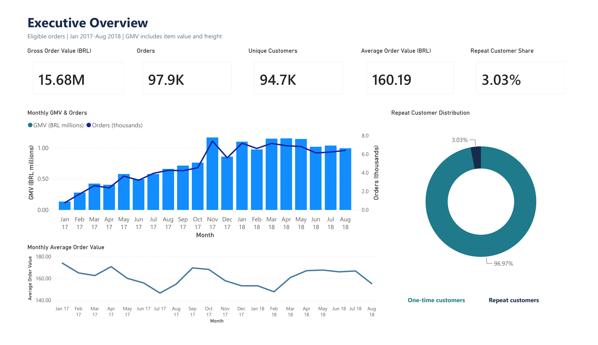
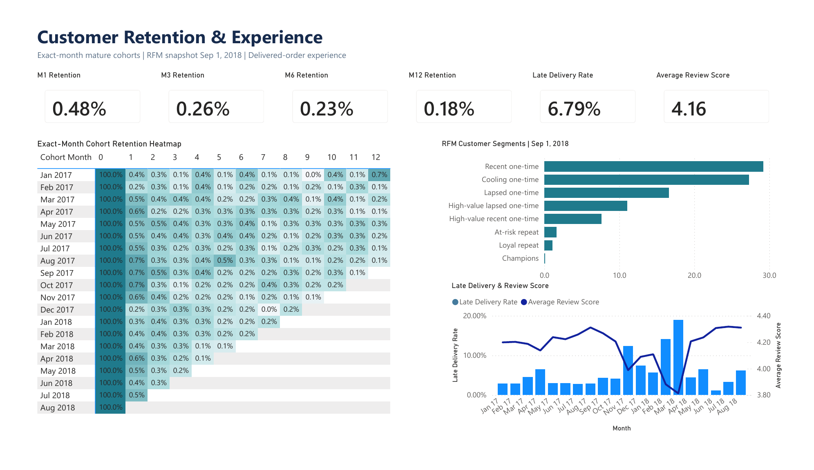
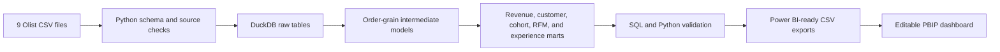

# Olist E-commerce Customer Retention & Revenue Analysis

A portfolio-grade analytics project that turns the public Olist marketplace dataset into a tested DuckDB analytics layer and an editable two-page Power BI dashboard. The analysis focuses on revenue, repeat purchasing, exact-month cohort retention, RFM segments, delivery performance, and customer reviews.

[View the dashboard PDF](docs/OlistRetentionDashboard.pdf) | [Read the executive summary](docs/executive_summary.md) | [Review metric definitions](docs/metric_definitions.md)

| Executive Overview | Customer Retention & Experience |
|---|---|
| [](docs/OlistRetentionDashboard.pdf) | [](docs/OlistRetentionDashboard.pdf) |

## Business problem

Marketplace leaders need a consistent view of commercial performance and customer behavior without overstating retention or duplicating revenue through one-to-many joins. This project answers five practical questions:

- How much gross order value and order volume did eligible orders generate?
- How many purchasing customers returned for another order?
- What share of each acquisition cohort purchased again in an exact later month?
- Which transparent RFM groups can support customer targeting?
- How do delivery timing, review coverage, and review scores behave over time?

## Dataset and reporting scope

The project uses the [Brazilian E-Commerce Public Dataset by Olist](https://www.kaggle.com/datasets/olistbr/brazilian-ecommerce), an anonymized collection of nine CSV files covering orders, customers, items, payments, reviews, products, sellers, geolocation, and category translations. Source CSVs are excluded from Git and must be downloaded separately.

Comparable dashboard metrics use purchases from **January 1, 2017 through August 31, 2018**. Eligible order statuses are `approved`, `processing`, `invoiced`, `shipped`, and `delivered`. Customer analysis uses `customer_unique_id`. RFM is a fixed snapshot as of **September 1, 2018**.

## Validated headline metrics

| Metric | Result | Definition |
|---|---:|---|
| Gross order value | 15,683,706.74 BRL | Item value plus freight for eligible reporting-period orders |
| Orders | 97,905 | Distinct eligible orders with a purchase timestamp |
| Unique customers | 94,703 | Distinct `customer_unique_id` values |
| Average order value | 160.19 BRL | Complete-case GMV divided by orders with item-derived GMV |
| Repeat customers | 2,874 | Customers with at least two eligible reporting-period orders |
| Repeat customer share | 3.03% | Repeat customers divided by all purchasing customers |
| M1 exact-month retention | 0.48% | Weighted retention across cohorts mature through month 1 |
| M3 / M6 / M12 retention | 0.26% / 0.23% / 0.18% | Weighted exact-month retention across mature cohorts |
| Late delivery rate | 6.79% | Delivered after the estimated calendar date |
| Average review score | 4.16 | Order-level average among reviewed delivered orders |

The repeat customer share is a within-period purchasing-customer ratio. It is **not** formal retention. Cohort retention measures activity in one exact calendar month after acquisition and excludes immature observation windows.

## What the analysis shows

- **One-time purchasing dominates.** 91,829 customers, or 96.97% of the reporting-period customer base, placed one eligible order.
- **Repeat behavior is limited.** The 2,874 repeat customers represent 3.03% of purchasing customers within the reporting window.
- **Exact-month return rates are low.** Weighted mature-cohort retention is 0.48% at M1 and 0.18% at M12. These are exact-month rates rather than cumulative survival rates.
- **RFM needs explicit thresholds.** Frequency percentiles are not meaningful when most customers have one order, so the model uses tie-preserving bands for 1, 2, and 3+ orders.
- **Delivery performance requires a calendar-day rule.** The validated late-delivery rate is 6.79%. Timestamp comparison would incorrectly classify same-day deliveries after midnight as late.
- **Financial joins reconcile.** Items, freight, and payments are aggregated independently before joining to orders, preventing monetary multiplication.

No causal business impact is claimed. The dataset contains marketplace transactions, not experiments, sessions, marketing exposure, margin, or profit.

## Methodology



1. **Profile the sources.** Validate file availability, actual columns, row counts, nulls, keys, duplicates, and date ranges.
2. **Build at safe grains.** Aggregate items, payments, and reviews separately before joining them to orders.
3. **Create reporting marts.** Produce monthly revenue, customer summaries, fixed-window cohorts, RFM segments, and delivery-review datasets.
4. **Control analytical scope.** Use one January 2017-August 2018 dashboard window while preserving explicitly named full-history exports.
5. **Test the outputs.** Reconcile money, joins, customer denominators, cohort maturity, RFM totals, delivery logic, and Power BI contracts.

## Metric guardrails

- **GMV** is item value plus freight. It is not Olist net revenue, margin, or profit.
- **Payments** remain separate from GMV because the two source concepts do not always match.
- Missing item, payment, and review records remain null or explicitly flagged; they are not replaced with synthetic values.
- Cohort metrics use exact calendar-month boundaries and null out right-censored windows.
- Review records are aggregated to order grain before joining.
- Website conversion is intentionally excluded because the dataset has no traffic or session denominator.

See [metric definitions](docs/metric_definitions.md) and the [analytics audit](docs/analytics_audit.md) for the complete contracts and limitations.

## Technology

- Python 3
- DuckDB 1.4.1
- SQL
- Power BI Desktop project format (PBIP/PBIR and TMDL)
- DAX
- Python `unittest`

## Repository structure

```text
.
|-- data/
|   |-- raw/                     # Olist source CSVs, excluded from Git
|   |-- processed/               # Reproducible exports, excluded from Git
|   `-- ecommerce.duckdb         # Rebuilt locally, excluded from Git
|-- docs/
|   |-- OlistRetentionDashboard.pdf
|   |-- dashboard-preview.png
|   |-- dashboard-preview-page-2.png
|   |-- executive_summary.md
|   |-- metric_definitions.md
|   |-- analytics_audit.md
|   `-- data_quality_report.md
|-- powerbi/
|   |-- pbip/                    # Editable report and semantic model
|   |-- theme/                   # Portfolio theme
|   |-- dax/                     # Measure reference
|   `-- README.md
|-- sql/                         # Staging, intermediate, marts, checks
|-- src/run_pipeline.py          # Pipeline entry point
|-- tests/test_pipeline.py       # Integration and regression tests
|-- requirements.txt
`-- README.md
```

## Reproduce the analytics layer

### 1. Prepare the source files

Place these files in `data/raw/`:

```text
olist_customers_dataset.csv
olist_geolocation_dataset.csv
olist_order_items_dataset.csv
olist_order_payments_dataset.csv
olist_order_reviews_dataset.csv
olist_orders_dataset.csv
olist_products_dataset.csv
olist_sellers_dataset.csv
product_category_name_translation.csv
```

The pipeline stops if a file is missing or its columns do not match the expected schema.

### 2. Create the environment and run the pipeline

From the repository root on Windows PowerShell:

```powershell
python -m venv .venv
.\.venv\Scripts\python.exe -m pip install -r requirements.txt
.\.venv\Scripts\python.exe src\run_pipeline.py
```

Optional paths are available through `--raw-dir`, `--output-dir`, and `--db-path`.

### 3. Run the automated tests

```powershell
.\.venv\Scripts\python.exe -m unittest discover -s tests -v
.\.venv\Scripts\python.exe powerbi\validate_powerbi_assets.py
powershell -ExecutionPolicy Bypass -File powerbi\validate_tmdl.ps1
```

The latest recorded analytics run completed 35 SQL checks with no critical failures, retained two documented source-quality warnings, and passed all six Python integration tests. The Power BI export contract recorded 56 passing checks and no failures.

Power BI Desktop may generate hidden Auto Date/Time tables when saving the PBIP. The strict Power BI validators intentionally flag those generated tables because the designed public model contains seven business tables and two explicit relationships. Disable Auto Date/Time before using the strict table-count validation for a publication build.

### 4. Open the editable dashboard

The semantic model reads six locally generated CSVs through one required Power Query text parameter named `DataFolder`. Its published placeholder is `C:\SET_DATA_FOLDER`; update it before the first refresh after cloning.

1. Run the pipeline so the six files below exist under `<repository>\data\processed\`.
2. Open `powerbi/pbip/OlistRetentionDashboard.pbip` in Power BI Desktop.
3. Select **Home > Transform data > Manage Parameters**, choose `DataFolder`, and set **Current Value** to the absolute path of the cloned repository's `data\processed` folder, for example `D:\Projects\ecommerce-retention-revenue-analysis\data\processed`. Do not include a trailing slash.
4. Select **Close & Apply** and refresh. The six queries append their own CSV filenames to `DataFolder`; no individual query paths need editing.

| Power Query | CSV under `data/processed/` |
|---|---|
| `Monthly Revenue` | `monthly_revenue_orders.csv` |
| `Customers` | `customer_purchase_summary.csv` |
| `Cohort Retention` | `cohort_retention.csv` |
| `Cohort Horizons` | `cohort_horizon_summary.csv` |
| `RFM Segments` | `rfm_segment_summary.csv` |
| `Monthly Experience` | `monthly_delivery_reviews.csv` |

Refresh will fail until `DataFolder` is changed from its placeholder and the six exports have been built. `File.Contents` always receives the absolute path produced from `DataFolder` plus the required filename; the model does not rely on relative-path behavior.

## Dataset license and attribution

The source data is the **Brazilian E-Commerce Public Dataset by Olist**, provided by **Olist** through [Kaggle](https://www.kaggle.com/datasets/olistbr/brazilian-ecommerce). Kaggle lists the dataset under the [Creative Commons Attribution-NonCommercial-ShareAlike 4.0 International license](https://creativecommons.org/licenses/by-nc-sa/4.0/) (**CC BY-NC-SA 4.0**).

This repository uses the dataset for noncommercial portfolio analysis. The source CSVs are not redistributed. They are transformed into analytical models, aggregate exports, documentation, and dashboard visuals; those modifications are described in the methodology and metric documentation. The dataset license applies to the source data and adaptations of it. It does not by itself grant a software license for the repository's code.

## Documentation

- [Executive summary](docs/executive_summary.md)
- [Dashboard PDF](docs/OlistRetentionDashboard.pdf)
- [Metric definitions and export contracts](docs/metric_definitions.md)
- [Analytics audit](docs/analytics_audit.md)
- [Generated data quality report](docs/data_quality_report.md)
- [Power BI delivery package](powerbi/README.md)

## Validation status

The analytics pipeline, business metric reconciliations, cohort maturity controls, RFM totals, delivery logic, and Power BI export contracts have been validated against the included processed results. The dashboard PDF is a static publication artifact; the editable PBIP requires Power BI Desktop for refresh and visual verification after cloning.
